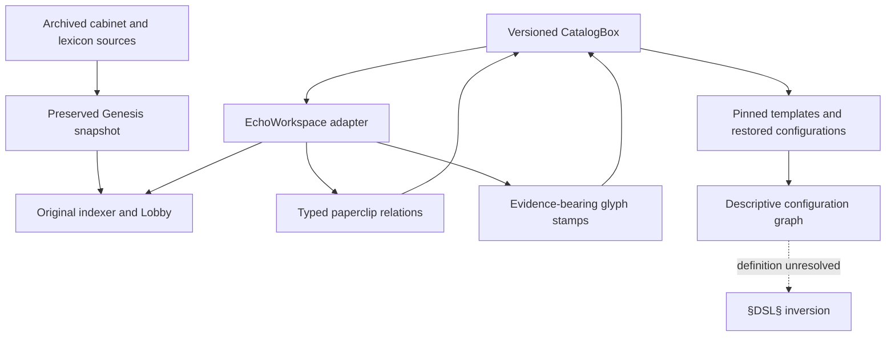

# Echo integration Matrix

The [source manifest](source-manifest.json) pins all 128 files of the Genesis Documentary snapshot. The original files are preserved under `vendor/echo-genesis/` without modifications. New runtime state remains in a caller-selected SQLite catalog, not committed to Git.

Component relationships:

The dotted relation is explicitly unresolved. Archived cabinet code is not a live connection to R2 or the local catalog. [Component guide](../../components/echo-integration/README.md).
